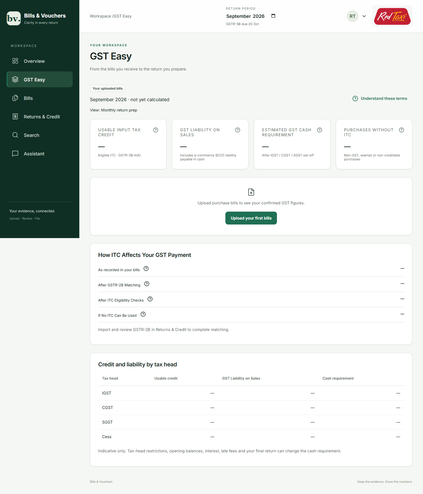
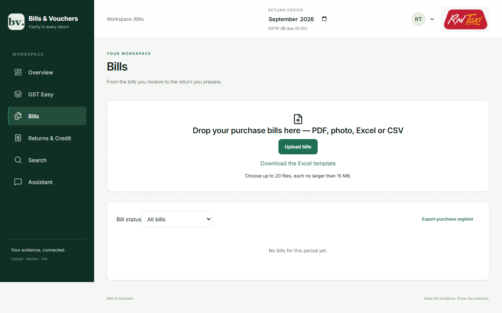
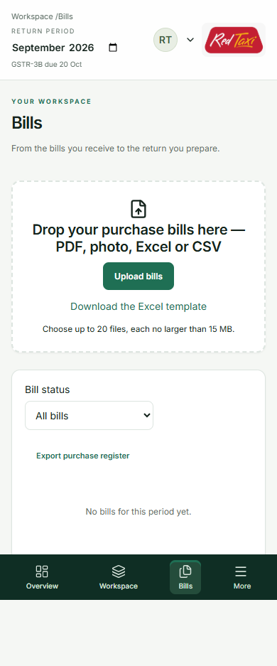

https://preview-v3---bills-voucher-web-foovqasysa-el.a.run.app

# GST Easy v3 release — 9 October 2026

Branch: [stephen_version3](https://github.com/ramamurthy-540835/Bills_Vouchers/tree/stephen_version3).

V3 is deployed for customer bill uploads, review, confirmation, purchase-register export and indicative GST calculations. Original and v2 preview URLs and production traffic are unchanged. No synthetic financial records were loaded into Red Taxi's workspace.

Subsequent owner-requested test workspace: [isolated test-client update](v3-test-workspace.md). Its API revision is `bills-voucher-00110-wuv`; the initial release evidence below remains historical. Synthetic bills are restricted to a separate test client, with exports and filing blocked.

## Deployment evidence

| Item | Value |
|---|---|
| Project / region | `aidirac-503309` / `asia-south1` |
| Successful two-image build | `cb2577e6-496b-4e15-bd60-27916043f695` |
| Image tag | `gst-easy-v3-20261009-r4` |
| Web revision / tag | `bills-voucher-web-00050-rij` / `preview-v3` |
| API revision / tag | `bills-voucher-00109-quv` / `api-preview-v3` |
| API URL | `https://api-preview-v3---bills-voucher-foovqasysa-el.a.run.app` |
| V3 production traffic | 0% for both revisions |
| Additive migration | `infra/bq/migrations/007_gst_invoice.sql` |
| Migration job | `bcbefbf5-cd1b-4829-9305-09a55109303f` |
| Durable queue | `projects/aidirac-503309/locations/asia-south1/queues/bills-v3` |

Build and deployment are separate: the repository-root Dockerfile builds FastAPI; `frontend/Dockerfile` builds Next.js. `scripts/deploy_v3.py` deploys the tested immutable image digests with `--no-traffic` to the v3 tags and compares all existing traffic/tag mappings before and after.

| Preserved target | Revision |
|---|---|
| Original web `preview` | `bills-voucher-web-00036-zoq` |
| Web `preview-v2` | `bills-voucher-web-00042-joq` |
| Web production, 100% | `bills-voucher-web-public-redtaxi-api` |
| API `v5-api` | `bills-voucher-00096-bik` |
| API `api-preview` | `bills-voucher-00098-fim` |
| API `v7-api` | `bills-voucher-00101-sip` |
| API production, 100% | `bills-voucher-redtaxi-account` |

## Applied copy and navigation

Customer copy is in `frontend/lib/copy/gst.ts`. `NEXT_PUBLIC_GST_MODULE_NAME` defaults to GST Easy and is passed as a frontend build argument for rebranding.

| Previous label | Current label / treatment |
|---|---|
| FINANCE CONTROL PLANE | Removed |
| GST Workspace | GST Easy |
| GST Filing & ITC | Returns & Credit |
| Documents | Bills |
| Actual customer records | Your uploaded bills |
| ISO period / months computed | Human month name and confirmed/review bill counts |
| Reporting view: Monthly preparation | View: Monthly return prep |
| Download working papers | Download CA working papers |
| Eligible ITC | Usable Input Tax Credit; technical caption retained |
| Output tax | GST Liability on Sales |
| Estimated cash | Estimated GST Cash Requirement |
| Non-GST purchases | Purchases Without ITC |
| Compare estimated cash | How ITC Affects Your GST Payment |
| As recorded | As recorded in your bills |
| Matched to GSTR-2B | After GSTR-2B Matching |
| After credit checks | After ITC Eligibility Checks |
| If credit is unavailable | If No ITC Can Be Used |
| Including ECO cash-only liability | Includes e-commerce (ECO) liability payable in cash |
| After tax-head set-off | After IGST / CGST / SGST set-off |
| Available after credit adjustments | After eligibility and matching adjustments |
| GSTIN pending | GSTIN not yet added, where applicable; absent from header |
| Profile-completion banner | Suppressed as previously requested; bill validation explains missing GSTIN |
| Sidebar process line | Upload · Review · File |

KPI/scenario explanations link to a glossary drawer with the live-number formula and an explicitly illustrative A/B/C matching table. The supplied prompt's explanations are implemented; the referenced DOCX was not available. Red Taxi's supplied PNG remains at the top right. The previous sample banners and Overview introduction remain removed.

## Bill workflow and routes

Customer routes: `/bills`, `/gst/workspace`, `/gst/filing`, `/settings/account`, `/settings/profile`. `/documents` redirects to `/bills` with HTTP 301; older APIs remain available for compatibility.

| Method | Route | Purpose |
|---|---|---|
| POST | `/api/gst/bills/upload` | Accept up to 20 PDF/photo/XLSX/CSV files and return a durable job ID |
| GET | `/api/gst/bills/upload/{job_id}` | Tenant-bound per-file progress |
| GET | `/api/gst/bills` | Period/status-filtered bills |
| GET / PATCH | `/api/gst/bills/{invoice_id}` | Read / edit and revalidate, with version conflict detection |
| POST | `/api/gst/bills/{invoice_id}/confirm` | Rerun validation and confirm |
| POST | `/api/gst/bills/{invoice_id}/reject` | Reject with audit history |
| GET | `/api/gst/bills/{invoice_id}/original` | Authenticated original-file access |
| GET | `/api/gst/bills/template.xlsx` | Excel template with instructions/dropdowns |
| GET | `/api/gst/bills/export` | Confirmed purchase register, XLSX or CSV |
| GET | `/api/gst/bills/dashboard` | Confirmed-record totals, scenarios, matching and tax heads |
| POST | `/api/gst/bills/gstr2b` | Import matching data for the client's GSTIN and selected period |
| GET | `/api/gst/bills/working-papers` | CA summary and line-level credit decisions |
| POST | `/api/gst/bills/internal/process` | OIDC-only Cloud Tasks worker; rechecks uploader permission |

Raw files and extracted JSON use authenticated client-first bronze/silver GCS paths. Canonical records use `gold.gst_invoice`, `silver.gst_invoice_line`, `silver.gst_bills_gstr2b` and operational job/audit/lock/extraction tables. Decimal values are strings in API JSON and NUMERIC in BigQuery. Queries bind tenant identifiers as parameters. Sample records cannot be persisted or exported through the canonical bill APIs.

The dashboard includes confirmed records only. Distinct scenarios use recorded, matched, eligibility-checked and unavailable credit; line-level decisions handle mixed credit eligibility, credit notes and tax-head set-off. Reverse-charge confirmation requires payment evidence recorded by admin/tax_admin. Missing GSTIN permits upload/review but blocks confirmation.

## Verification

| Check | Result |
|---|---|
| Full backend suite, including existing regression suite | 129 passed |
| Local browser suite, including CSV upload/edit/reject | 3 passed |
| Live browser suite | 2 passed; 1 synthetic-upload test intentionally skipped |
| Live authenticated API smoke | 6 groups passed |
| Live Cloud Tasks OIDC/permission/job processing | Passed using one empty operational job; zero financial records |
| TypeScript and changed-module Ruff checks | Passed |
| Forbidden legacy-label source search | Zero hits in frontend/app; intentional CA caption remains in lib/copy |
| BigQuery account SQL dry run | Passed |
| Invoice and matching transactional SQL probes | Passed and rolled back; zero retained verification invoices |
| Actual Vertex response-schema compatibility | Passed; test image stayed in memory |
| Existing traffic/tag comparison | Unchanged |

Permission tests cover viewer read/export versus write denial, client/admin/tax_admin access, cross-client IDs returning 404, and canonical uploads remaining available despite legacy sample mode. Validation tests cover GSTIN checksum, tax heads, Decimal arithmetic/tolerance, rate/HSN rules, financial-year duplicates, passenger-transport eligibility, mixed invoices, credit notes, file validation and partial-job retry behavior.

Live tests check login, September/October dashboard isolation and decimal strings, templates and exports, unavailable invoice/source/job IDs, authenticated write rejection for missing IDs, invalid upload rejection and CSRF origin enforcement. They do not assert a successful real customer bill ingestion/confirmation cycle; that requires actual evidence and the client's completed GSTIN profile.

## Screenshots from the deployed preview

## Limits and next acceptance work

- The glossary DOCX has not been supplied; integrate its remaining requested sections when available.
- Complete the client's real GSTIN profile, then verify actual customer evidence through upload, original download, correction, confirmation, matching and export. No mock customer bill was created for this release.
- GSTR-2B ingestion covers B2B invoice records. Full amendment/CDNR ingestion, opening-credit-ledger management and filing submission are not implemented by this v3 bill flow. Cash figures remain indicative and require CA review.
- See [remaining-work handoff](../STEPHEN_VERSION3_REMAINING.md) and [recorded decisions](../decisions/v7.md). Local diagnostic evidence is under ignored `artifacts/v3/`; only the selected screenshots are committed.
